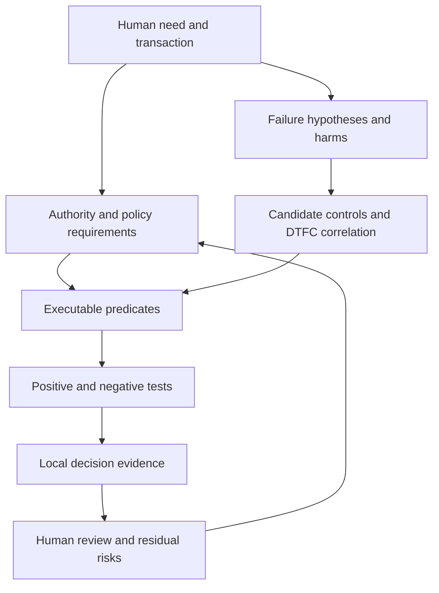

# From transaction to policy and assurance

Begin with the affected person and the consequence of the transaction, not the credential or API. Describe the normal journey and refusal, unresolved, retry, withdrawal and remediation branches. Identify which participant owns each state transition.

## Policy design worksheet

| Question | Required design output |
|---|---|
| What may change externally? | Exact action, target, terms, consequence and terminal state |
| Who can authorize it? | Principal, delegate, competent policy owner, scope, validity, revocation source |
| What must be known? | Evidence proposition, source, freshness bound, conflict handling |
| What if evidence is absent? | Explicit deny or defer; resolution path, deadline, accountable party |
| What happens after permit? | Current authority check, exact request binding, native execution and reconciliation |
| What can fail? | Trigger, unsafe transition, affected parties, harm, mitigation and residual risk |
| What can be established later? | Decision basis, external outcome, retention and access limits |

## Evidence status

Use these labels consistently:

- **Executable:** existing offline request, policy, evidence and authority fixtures evaluated by the actual runner.
- **Illustrative:** a hypothetical business flow or failure mechanism; no executed test establishes the full proposition.
- **External:** a required control or determination owned by a real service or institution, not implemented here.

A local scenario may illustrate part of a DTFC failure proposition while exercising only one predicate. Never claim canonical case satisfaction without establishing its preconditions, trigger, evidence and falsification criteria. A test of a simulated revoked flag does not establish revocation propagation or freshness.

Text equivalent: derive policy and failure hypotheses from the transaction, translate selected controls to predicates, execute tests, review evidence and revise policy. The deploying institution owns risk acceptance.

## Authoring and maintenance

Keep the domain guide in this documentation site and the executable assets under the corresponding example directory. The scenario index describes the existing runner cases and links to immutable DTFC sources. It is an informative index, not an authority source or a new execution contract. Update it whenever fixtures change. Do not include real personal data or live credentials. Record the difference between a simulated observation and a verified upstream determination.
