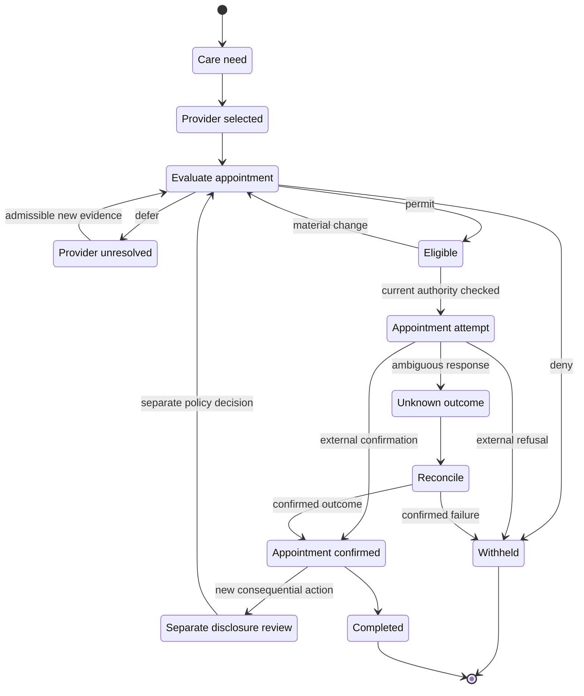

# Healthcare appointment and consent

## Human need and transaction

Arjun wants help arranging a dermatology appointment. A clinic requests intake information. Scheduling and sharing health information are distinct decisions with different consequences. The fictional raw-genetic-data request is a deliberately sensitive stress case, not a claim that such data is clinically necessary for dermatology intake.

## Actors and authority

Arjun controls the personal mandate and relevant consent decisions; the clinic owns appointment availability and its processing obligations; the provider registry supplies recognition evidence; competent clinical and legal authorities establish necessity and applicable exceptions. The agent cannot decide clinical necessity or infer consent.

## Transaction lifecycle

The following is an illustrative transaction pattern, not an implemented business state machine. Later actions require their own policy and must not reuse the initial decision as authority.



Text equivalent: Care need leads to provider selected and evaluate appointment. Deferral requires admissible new evidence, denial withholds action, and permit only makes the candidate eligible. Changed terms return to evaluation. The native service determines the actual outcome. An ambiguous response must be reconciled before retry. Any later consequential action requires a separate decision; the later-action loop represents that new decision, not reuse of the initial policy.

## Policy formulation

| Policy proposition | Accountable source | Control or predicate | Status |
|---|---|---|---|
| Specialty and provider | Principal and registry | Appointment scope and approved provider predicates | Executable |
| Purpose and data class | Principal and applicable governance | Disclosure rules and prohibited class | Executable |
| Exact recipient, purpose, consent validity | Consent authority and provider | Independent request-bound consent and necessity | External |
| Withdrawal, onward use and retention | Data controller and applicable authority | Separate processing control and deletion obligations | External |

## Failure hypotheses and potential consequences

All consequences below are hypothetical. DTFC links are illustrative correlations to draft v0.1.0 cases, not conformance or observed failure evidence. A named fixture exercises only a local predicate.

| Trigger | Potential harm | Control | DTFC correlation | Local fixture |
|---|---|---|---|---|
| Unverified provider | Unsafe referral or delayed care | Defer and obtain recognition evidence | [DTF-010](https://github.com/qbf-consulting/digital-trust-failure-corpus/blob/1eda75842cf3b268361dc47ce8ade23b6a99c5cb/corpus/evidence/DTF-010.json) | `provider-verification-required` |
| Excessive disclosure | Loss of confidentiality | Prohibit complete record | [DTF-002](https://github.com/qbf-consulting/digital-trust-failure-corpus/blob/1eda75842cf3b268361dc47ce8ade23b6a99c5cb/corpus/authority/DTF-002.json) | `full-record-prohibited` |
| Missing purpose | Unjustified processing | Require explicit purpose | [DTF-010](https://github.com/qbf-consulting/digital-trust-failure-corpus/blob/1eda75842cf3b268361dc47ce8ade23b6a99c5cb/corpus/evidence/DTF-010.json) | `missing-disclosure-purpose` |
| Changed recipient after consent | Sensitive data disclosed to wrong party | Bind recipient and payload | [DTF-017](https://github.com/qbf-consulting/digital-trust-failure-corpus/blob/1eda75842cf3b268361dc47ce8ade23b6a99c5cb/corpus/authority/DTF-017.json) | Illustrative only |
| Legitimate disclosure reused | Secondary processing without basis | Separate downstream purpose evaluation | [DTF-034](https://github.com/qbf-consulting/digital-trust-failure-corpus/blob/1eda75842cf3b268361dc47ce8ade23b6a99c5cb/corpus/privacy/DTF-034.json) | Illustrative only |
| Retained receipts expose data | Durable sensitive correlation | Minimize and govern retention | [DTF-037](https://github.com/qbf-consulting/digital-trust-failure-corpus/blob/1eda75842cf3b268361dc47ce8ade23b6a99c5cb/corpus/privacy/DTF-037.json) | Illustrative only |

## Run and inspect

From the repository root after `pip install -e ".[dev]"`:

```bash
python examples/healthcare-agent/run.py all
```

[Execution guide](../../examples/healthcare-agent/README.md) and [scenario index](../../examples/healthcare-agent/scenarios.json) identify the concrete fixtures and expected local decisions. Inspect the emitted receipt, including rule outcomes and failure categories. Use retained-input verification to reproduce it; this does not authenticate the underlying evidence or prove actual business execution.

## Residual risks and policy decisions

The existing consent fixture changes the synthetic autonomous-data-class list; the consent member is not independently validated or request-bound. Disclosure policy does not verify recipient authority or clinical necessity. No appointment or health-data transfer occurs.

What data is genuinely necessary? Who can authorize an exception? How is consent withdrawn and communicated? What accessible escalation route prevents delay of necessary care?

See the [case-study method](governance-case-study-method.md) and [cross-domain analysis](cross-domain-failure-analysis.md).
