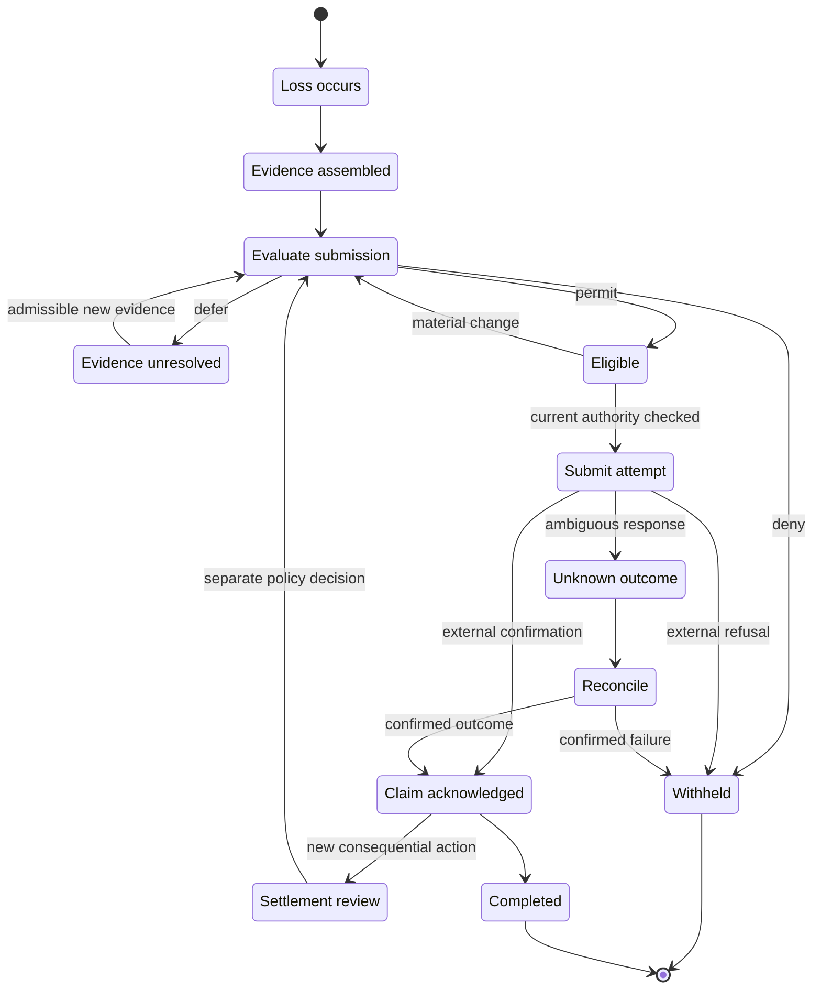

# Insurance claim

## Human need and transaction

Leena's flight is cancelled. Her agent gathers booking, cancellation and payment evidence and proposes a claim. Later the insurer may offer a settlement. Submitting documents is not the same as accepting a full-and-final settlement or waiving further claims.

## Actors and authority

Leena owns the mandate and settlement decision within applicable law; the insurer owns claim adjudication and offer terms; airline and payment provider supply evidence; an adjudicator or dispute mechanism may resolve disagreement. The agent submits or proposes acceptance only within scope.

## Transaction lifecycle

The following is an illustrative transaction pattern, not an implemented business state machine. Later actions require their own policy and must not reuse the initial decision as authority.



Text equivalent: Loss occurs leads to evidence assembled and evaluate submission. Deferral requires admissible new evidence, denial withholds action, and permit only makes the candidate eligible. Changed terms return to evaluation. The native service determines the actual outcome. An ambiguous response must be reconciled before retry. Any later consequential action requires a separate decision; the later-action loop represents that new decision, not reuse of the initial policy.

## Policy formulation

| Policy proposition | Accountable source | Control or predicate | Status |
|---|---|---|---|
| Claim type and policy status | Principal and insurer | Scope and supplied active-policy predicate | Executable |
| Required booking, cancellation and payment evidence | Insurer | Presence flags; defer if missing | Executable |
| Settlement amount and currency | Principal | Separate settlement policy | Executable |
| Offer finality, waiver and adjudication | Insurer and principal | Exact offer, coverage determination and explicit acceptance | External |

## Failure hypotheses and potential consequences

All consequences below are hypothetical. DTFC links are illustrative correlations to draft v0.1.0 cases, not conformance or observed failure evidence. A named fixture exercises only a local predicate.

| Trigger | Potential harm | Control | DTFC correlation | Local fixture |
|---|---|---|---|---|
| Payment evidence absent | Unsupported claim or avoidable delay | Defer pending admissible evidence | [DTF-010](https://github.com/qbf-consulting/digital-trust-failure-corpus/blob/1eda75842cf3b268361dc47ce8ade23b6a99c5cb/corpus/evidence/DTF-010.json) | `missing-evidence` |
| Valid evidence later supplied but ignored | Unnecessary claim delay | Re-evaluate same candidate | [DTF-031](https://github.com/qbf-consulting/digital-trust-failure-corpus/blob/1eda75842cf3b268361dc47ce8ade23b6a99c5cb/corpus/lifecycle/DTF-031.json) | `payment-evidence-resolved` |
| Settlement authority exceeded | Loss of rights or unwanted compromise | Separate bounded acceptance rule | [DTF-002](https://github.com/qbf-consulting/digital-trust-failure-corpus/blob/1eda75842cf3b268361dc47ce8ade23b6a99c5cb/corpus/authority/DTF-002.json) | `settlement-approval-required` |
| Changed full-and-final offer | Unapproved waiver | Bind complete offer and authority | [DTF-017](https://github.com/qbf-consulting/digital-trust-failure-corpus/blob/1eda75842cf3b268361dc47ce8ade23b6a99c5cb/corpus/authority/DTF-017.json) | Illustrative only |
| Evidence flags treated as adjudication | False entitlement | Validate source documents and insurer outcome | [DTF-030](https://github.com/qbf-consulting/digital-trust-failure-corpus/blob/1eda75842cf3b268361dc47ce8ade23b6a99c5cb/corpus/evidence/DTF-030.json) | Illustrative only |

## Run and inspect

From the repository root after `pip install -e ".[dev]"`:

```bash
python examples/insurance-claim-agent/run.py all
```

[Execution guide](../../examples/insurance-claim-agent/README.md) and [scenario index](../../examples/insurance-claim-agent/scenarios.json) identify the concrete fixtures and expected local decisions. Inspect the emitted receipt, including rule outcomes and failure categories. Use retained-input verification to reproduce it; this does not authenticate the underlying evidence or prove actual business execution.

## Residual risks and policy decisions

The evidence flags are synthetic, not validated documents. Active policy status is a supplied boolean, not a coverage determination. No claim is sent, adjudicated, accepted, paid or disputed by the runner.

Which evidence is sufficient for submission versus adjudication? Is active status at loss date or submission relevant? What rights does settlement waive? Who can approve a changed offer or reopen a dispute?

See the [case-study method](governance-case-study-method.md) and [cross-domain analysis](cross-domain-failure-analysis.md).
