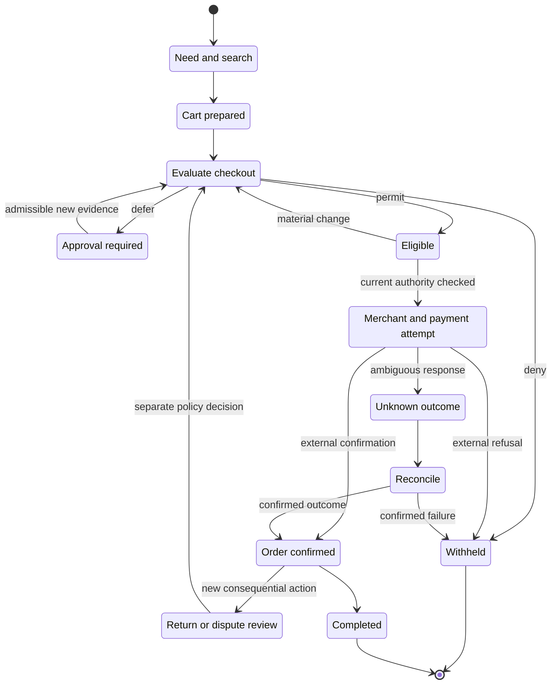

# Personal shopping

## Human need and transaction

Maya asks her shopping agent to find a book and purchase it within her personal policy. A cart may change merchant, quantity, taxes or commitment type before checkout. The existing fixture proposes a one-time INR 1,800 book purchase; the agent's ability to browse or populate a cart does not grant authority to buy.

## Actors and authority

Maya owns the mandate and spending policy; the merchant owns the actual offer and fulfilment; marketplace and payment provider own their respective acceptance and settlement decisions. The agent proposes the purchase, not the payment authority.

## Transaction lifecycle

The following is an illustrative transaction pattern, not an implemented business state machine. Later actions require their own policy and must not reuse the initial decision as authority.



Text equivalent: Need and search leads to cart prepared and evaluate checkout. Deferral requires admissible new evidence, denial withholds action, and permit only makes the candidate eligible. Changed terms return to evaluation. The native service determines the actual outcome. An ambiguous response must be reconciled before retry. Any later consequential action requires a separate decision; the later-action loop represents that new decision, not reuse of the initial policy.

## Policy formulation

| Policy proposition | Accountable source | Control or predicate | Status |
|---|---|---|---|
| Allowed category and merchant | Maya | Category and merchant membership | Executable |
| No recurring commitments; currency and amount | Maya | Commitment type and spending threshold | Executable |
| Final cart and total including fees | Merchant and principal | Exact checkout binding and re-evaluation | External |
| Cumulative budget and duplicate charges | Principal and payment provider | Atomic budget reservation and idempotency | External |

## Failure hypotheses and potential consequences

All consequences below are hypothetical. DTFC links are illustrative correlations to draft v0.1.0 cases, not conformance or observed failure evidence. A named fixture exercises only a local predicate.

| Trigger | Potential harm | Control | DTFC correlation | Local fixture |
|---|---|---|---|---|
| Subscription substituted | Recurring unwanted charges | Re-evaluate commitment type | [DTF-015](https://github.com/qbf-consulting/digital-trust-failure-corpus/blob/1eda75842cf3b268361dc47ce8ade23b6a99c5cb/corpus/authority/DTF-015.json) | `recurring-subscription` |
| Merchant substituted | Untrusted counterparty | Merchant scope predicate | [DTF-002](https://github.com/qbf-consulting/digital-trust-failure-corpus/blob/1eda75842cf3b268361dc47ce8ade23b6a99c5cb/corpus/authority/DTF-002.json) | `untrusted-merchant` |
| Missing commitment type | Unknown contractual obligation | Fail closed on missing operand | [DTF-010](https://github.com/qbf-consulting/digital-trust-failure-corpus/blob/1eda75842cf3b268361dc47ce8ade23b6a99c5cb/corpus/evidence/DTF-010.json) | `missing-commitment-type` |
| Cart changed after approval | Unapproved price or goods | Request-bound approval | [DTF-017](https://github.com/qbf-consulting/digital-trust-failure-corpus/blob/1eda75842cf3b268361dc47ce8ade23b6a99c5cb/corpus/authority/DTF-017.json) | Illustrative only |
| Split purchases bypass budget | Cumulative overspend | Atomic cumulative budget control | Not mapped | Illustrative only |

## Run and inspect

From the repository root after `pip install -e ".[dev]"`:

```bash
python examples/personal-shopping/run.py all
```

[Execution guide](../../examples/personal-shopping/README.md) and [scenario index](../../examples/personal-shopping/scenarios.json) identify the concrete fixtures and expected local decisions. Inspect the emitted receipt, including rule outcomes and failure categories. Use retained-input verification to reproduce it; this does not authenticate the underlying evidence or prove actual business execution.

## Residual risks and policy decisions

The runner checks a single candidate; it does not establish merchant trust, reserve cumulative budget, place orders, debit accounts or manage returns. A trusted-merchant fixture is not external recognition evidence.

Is the limit per item, per cart or per period? Who authorizes substitutions? How are refunds reflected in available budget? Who handles an ambiguous payment result?

See the [case-study method](governance-case-study-method.md) and [cross-domain analysis](cross-domain-failure-analysis.md).
