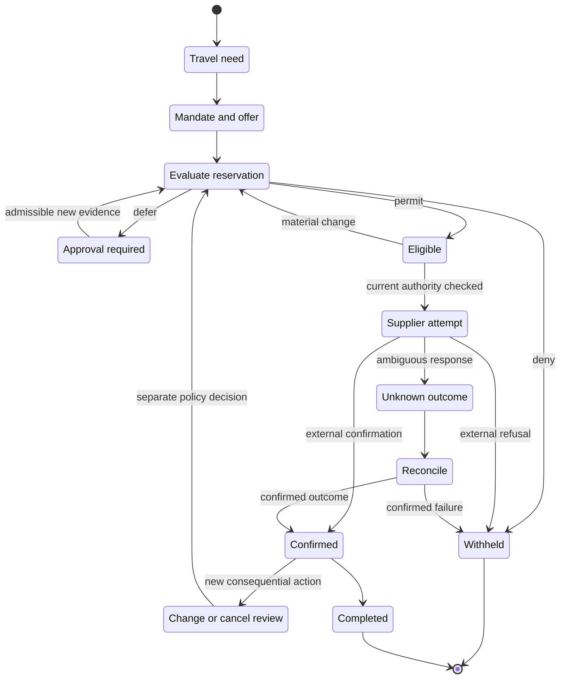

# Travel and hospitality

## Human need and transaction

Priya needs accommodation in Singapore for a work trip. Her employer sets reimbursable terms, she delegates a bounded booking action, and the hotel supplies an offer. An apparently acceptable room can become unacceptable when its price, refundability or availability changes before confirmation. The fixture models a reservation candidate for 14–17 September 2026, not a live booking or current offer.

## Actors and authority

Priya owns the personal mandate; the employer owns expense policy; the hotel owns offer validity, inventory and reservation status; a payment provider owns payment authorization; the agent proposes actions. Cancellation and refund rights arise from the actual contract, not the local decision receipt.

## Transaction lifecycle

The following is an illustrative transaction pattern, not an implemented business state machine. Later actions require their own policy and must not reuse the initial decision as authority.



Text equivalent: Travel need leads to mandate and offer and evaluate reservation. Deferral requires admissible new evidence, denial withholds action, and permit only makes the candidate eligible. Changed terms return to evaluation. The native service determines the actual outcome. An ambiguous response must be reconciled before retry. Any later consequential action requires a separate decision; the later-action loop represents that new decision, not reuse of the initial policy.

## Policy formulation

| Policy proposition | Accountable source | Control or predicate | Status |
|---|---|---|---|
| Refundable approved offer | Employer | Supplier, terms and rate predicates | Executable |
| Within delegated destination, dates and total | Principal | Action, dates, currency and limit rules | Executable |
| Current offer and mandate at execution | Hotel and mandate source | Freshness, expiry, revocation and exact terms | External |
| Modification, cancellation and refund | Contracting parties | Separate authority and penalty review | Illustrative |

## Failure hypotheses and potential consequences

All consequences below are hypothetical. DTFC links are illustrative correlations to draft v0.1.0 cases, not conformance or observed failure evidence. A named fixture exercises only a local predicate.

| Trigger | Potential harm | Control | DTFC correlation | Local fixture |
|---|---|---|---|---|
| Repriced offer reused | Unexpected financial obligation for traveller/employer | Re-evaluate complete revised offer | [DTF-015](https://github.com/qbf-consulting/digital-trust-failure-corpus/blob/1eda75842cf3b268361dc47ce8ade23b6a99c5cb/corpus/authority/DTF-015.json) | `supplier-repriced` |
| Revocation ignored | Unauthorized reservation | Current mandate and execution-time check | [DTF-016](https://github.com/qbf-consulting/digital-trust-failure-corpus/blob/1eda75842cf3b268361dc47ce8ade23b6a99c5cb/corpus/authority/DTF-016.json) | `revoked-mandate` |
| Paid upgrade outside scope | Unapproved cost | Separate action authorization | [DTF-002](https://github.com/qbf-consulting/digital-trust-failure-corpus/blob/1eda75842cf3b268361dc47ce8ade23b6a99c5cb/corpus/authority/DTF-002.json) | `paid-upgrade-out-of-scope` |
| Approval reused for different terms | Binding unwanted contract | Payload-bound expiring approval | [DTF-017](https://github.com/qbf-consulting/digital-trust-failure-corpus/blob/1eda75842cf3b268361dc47ce8ade23b6a99c5cb/corpus/authority/DTF-017.json) | Illustrative only |
| Supplier timeout and blind retry | Duplicate booking or payment | Idempotency and supplier reconciliation | Not mapped | Illustrative only |

## Run and inspect

From the repository root after `pip install -e ".[dev]"`:

```bash
python examples/travel-hospitality/run.py all
```

[Execution guide](../../examples/travel-hospitality/README.md) and [scenario index](../../examples/travel-hospitality/scenarios.json) identify the concrete fixtures and expected local decisions. Inspect the emitted receipt, including rule outcomes and failure categories. Use retained-input verification to reproduce it; this does not authenticate the underlying evidence or prove actual business execution.

## Residual risks and policy decisions

The runner evaluates reservation candidates only; it does not search inventory, validate offer expiry, charge, confirm, modify, cancel or refund. The paid-upgrade fixture is an out-of-scope negative case, not an upgrade implementation.

Who may approve a higher rate? Does reservation authority include payment or cancellation? Who bears cancellation costs after revocation? What is the deadline for reconciliation before a retry?

See the [case-study method](governance-case-study-method.md) and [cross-domain analysis](cross-domain-failure-analysis.md).
