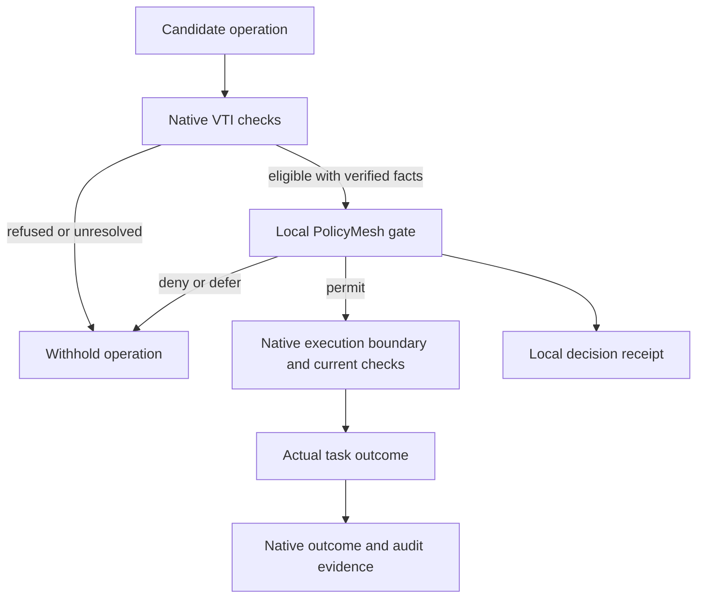

# PolicyMesh and DTG/VTI

PolicyMesh is an independent executable-policy and decision-evidence implementation adjacent to the Decentralized Trust Graph (DTG) work. The joint ToIP/DIF working group describes Verifiable Trust Infrastructure (VTI) as DTG implemented on the ToIP stack. The [VTI specification](https://trustoverip.github.io/dtgwg-vti-spec/) is the umbrella specification; [OpenVTC's VTI workspace](https://github.com/OpenVTC/verifiable-trust-infrastructure) implements VTA and VTC services, and [OpenVTC](https://github.com/OpenVTC/openvtc) is a client.

PolicyMesh does not replace the VTI access-control engine, native policy mechanisms, approvals, Trust Task transport, credential verification or audit trail. It is not an official DTG component, required dependency, or conforming VTI implementation. Its useful position is an additional, locally governed application decision boundary.

## Integration boundary

| Upstream responsibility | PolicyMesh input or output | Limit |
|---|---|---|
| VTA/VTC access control, trust contexts and capabilities | Verified operation, acting subject, scope and current authority determination | No derivation of VTI grants or context ancestry |
| Trust Task producer/consumer | Exact operation reference and independently verified document/payload binding | No transport, proof, replay or task-envelope validation |
| DTG credentials and ZKP | Verified claims or minimum necessary predicates | No native proof verifier or issuer-authority inference |
| Approvals and consent | Verified request-bound approval facts | No approval issuance, redemption or atomic consumption |
| Registry | Scoped, current determination from an authoritative source | No implicit recognition-to-authority conversion |
| HTX | Request-bound confirmation outcome, unresolved state | Confirmation does not establish authority |
| RAHP | Local rules and positive/negative test evidence | No automatic assessment, guardrail acceptance or risk acceptance |
| VDS, relationship cards and naming | Resolved, verified attributes when needed | Discovery and integrity do not confer authorization |

A VTI node retains its native enforcement responsibilities. A local application may withhold an operation even when the upstream authorization check succeeds; a local permit cannot override a VTI refusal. An integration must not add private fields to closed canonical task payloads or derive authority from extension data.

The diagram is a proposed application integration pattern, not a claim about an existing VTI hook. A preflight determination cannot replace authoritative checks at execution. Native refusal, protocol error, blocked task, indeterminate evidence, local deny/defer and actual task completion must remain distinguishable. PolicyMesh `permit` is not a Trust Task response or a ceremony outcome.

## Credential and authority semantics

The current DTG credential draft distinguishes evidence credentials, membership/relationship credentials and Verifiable Authority Credentials (VACs). A VAC grants scoped action in the subject's own name, potentially with attenuation; it is not itself delegation to act on behalf of the issuer. Preserve the acting subject, grant lineage, scope, validity, issuer authority and revocation determination separately. Never infer permission from possession of a credential, a verified signature, a relationship, membership or an authenticated transport.

Use the upstream implementation's [DTG Credentials v1 policy migration guidance](https://github.com/OpenVTC/verifiable-trust-infrastructure/blob/2316fbd2f64a5e33f7fff06df7efec2aec4f269c/docs/03-vtc/policy-upgrade-dtg-v1.md) when adapting credential-derived facts. Do not assume PolicyMesh consumes native credential or Rego policy formats.

## Requirement-level alignment

The following is an informative mapping to reviewed draft requirements, not a conformance assessment. All upstream propositions remain unassessed by PolicyMesh.

| VTI requirement | Integration obligation | PolicyMesh contribution |
|---|---|---|
| CTX-016/017 | Compare context ancestry by segments; preserve scope | Consume a verified scope determination |
| ACL-001/004 | Explicit grants and expiry at decision time | Reject absent or nonmatching local predicates |
| APV-004/006/008 | Exact-payload approval, competent approver, expiry and single redemption | Consume verified approval facts; defer unresolved approval |
| AUD-002/003/005 | Acting subject, refusals and privacy-aware audit | Local decision receipt; not an upstream audit event |
| OPS-010/012 | Preserve closed canonical payloads; no extension-derived authority | Keep normalized inputs outside the native payload |
| CMP-020/021 | Distinguish execution from semantic completion | Local permit is not outcome evidence |
| CMP-030/031 | Separate verification, authority and decision | Explicit input predicates and decision evidence |
| CMP-040/041 | Currency and stated freshness bounds | Consume current determination; withhold on unknown |
| CMP-050–053 | Preserve attenuation, lineage and acting delegate | Retain normalized authority context |
| CNF-010–013 | Requirement-linked assessment with method, artifacts and disposition | Local reproducible tests only; no upstream disposition |

## Adoption and assurance

Start with the [synthetic VTI-oriented operation example](vti-local-gate.md). It demonstrates a supplementary policy gate using mock normalized facts, not a VTI connection. Before live integration, select a named task version, native operation and authoritative verification interface; define input provenance, freshness and request binding; preserve native errors; test negative cases and execution-time rechecks. Do not assume a native integration point exists merely because the example runs.

The upstream RAHP method distinguishes continuous controls, binary guardrails and assurance tests. A local receipt or test result is evidence for review, not a RAHP finding, guardrail acceptance or risk-acceptance decision. HTX pattern P18.01 likewise distinguishes independent confirmation from launching a communication or authorizing changed details. Preserve unresolved outcomes, human agency and privacy. Action receipts may retain raw evaluated attributes; minimize upstream data before evaluation and protect evidence retention.

## Reviewed upstream baseline (2026-11-24)

These immutable revisions identify the documents reviewed; they are not compatibility certifications. The VTI specification's Appendix F records implementation divergence; review it before adopting any concrete interface.

- [DTGWG overview](https://github.com/trustoverip/dtgwg-general/blob/610df666e0a237b109c3ed6656181f9d3479a45f/README.md).
- VTI draft: [contexts](https://github.com/trustoverip/dtgwg-vti-spec/blob/83e88fcf8760f6bd159bbac09a27b002f5b656c2/spec/03-trust-contexts.md), [ACL](https://github.com/trustoverip/dtgwg-vti-spec/blob/83e88fcf8760f6bd159bbac09a27b002f5b656c2/spec/03a-access-control.md), [approvals](https://github.com/trustoverip/dtgwg-vti-spec/blob/83e88fcf8760f6bd159bbac09a27b002f5b656c2/spec/03b-approvals.md), [audit](https://github.com/trustoverip/dtgwg-vti-spec/blob/83e88fcf8760f6bd159bbac09a27b002f5b656c2/spec/03c-audit.md), [operations](https://github.com/trustoverip/dtgwg-vti-spec/blob/83e88fcf8760f6bd159bbac09a27b002f5b656c2/spec/08-operations.md), [composition](https://github.com/trustoverip/dtgwg-vti-spec/blob/83e88fcf8760f6bd159bbac09a27b002f5b656c2/spec/14-composition.md), [conformance](https://github.com/trustoverip/dtgwg-vti-spec/blob/83e88fcf8760f6bd159bbac09a27b002f5b656c2/spec/95-conformance.md), [Appendix F](https://github.com/trustoverip/dtgwg-vti-spec/blob/83e88fcf8760f6bd159bbac09a27b002f5b656c2/spec/appendix.md).
- [Trust Task specification](https://github.com/trustoverip/dtgwg-trust-tasks-spec/blob/bdf2cdd9256f9d7b98fe8b40c776124fc27a6084/spec/body.md).
- [DTG VAC definition](https://github.com/trustoverip/dtgwg-cred-spec/blob/634e0b0495abef9ca376901026074e4f20e5636e/spec/terms-definitions/verifiable_authority_credential.md).
- [VTI implementation](https://github.com/OpenVTC/verifiable-trust-infrastructure/tree/2316fbd2f64a5e33f7fff06df7efec2aec4f269c), [OpenVTC client](https://github.com/OpenVTC/openvtc/tree/92f82b8989dcdab3e3a1c8ce45be556e80d8f6b2).
- [RAHP assurance progression](https://github.com/trustoverip/dtgwg-rahp-tf/blob/cfecfeb053eb0bde2a4397ce02c6d194b0cf8ae1/docs/how-rahp-builds-assurance-incrementally.md).
- [HTX P18.01](https://github.com/trustoverip/dtgwg-htx-tf/blob/1dfdff348720babec3aa39ade0571e85961bf998/docs/patterns/p18-01.md).

Related: [authority boundaries](../concepts/authority-boundaries.md), [agentic systems](agentic-systems.md), [registry interoperability](registry.md), [decision receipts](../decision-receipts.md), [DTG Portfolio Monitor](https://sankarshanmukhopadhyay.github.io/dtg-portfolio-monitor/).
